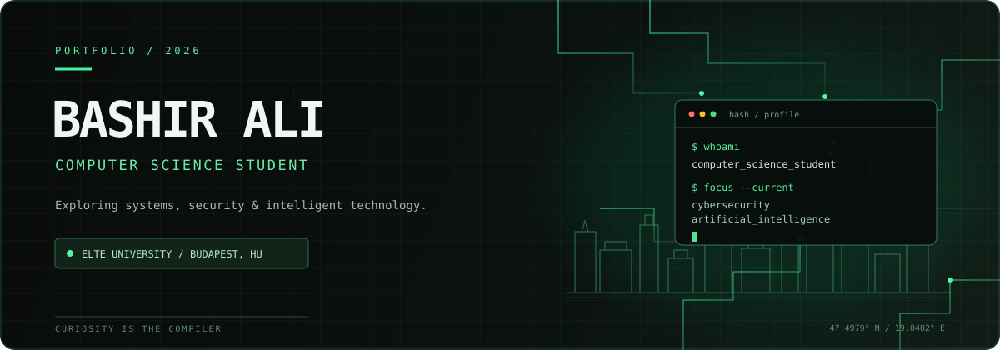

<div align="center">
  
</div>

<br/>

<div align="center">
  <a href="https://github.com/bashir-aly99">GitHub</a>
  &nbsp; / &nbsp;
  <a href="https://www.linkedin.com/in/bashir-aly/">LinkedIn</a>
  &nbsp; / &nbsp;
  <a href="https://github.com/bashir-aly99/Bashir-Ali-Portfolio">Portfolio</a>
</div>

<br/>

## 01 / ABOUT

I'm **Bashir Ali**, a Computer Science student at **Eötvös Loránd University (ELTE)** in Budapest, Hungary.

My interests sit at the intersection of cybersecurity, software development, and artificial intelligence. I'm focused on strengthening my foundations, experimenting with new ideas, and turning what I learn into practical projects.

```text
CURRENT MODE
├── Learning computer science
├── Exploring cybersecurity
├── Building development skills
└── Investigating AI
```

## 02 / TECHNOLOGIES

| Area | Technologies |
|:--|:--|
| Languages | C · Java · Python · JavaScript |
| Web | HTML · CSS fundamentals |
| Tools | Git · GitHub · VS Code |
| Exploring | Cybersecurity · AI · Ethical hacking |

## 03 / SELECTED WORK

### Bashir Ali Portfolio
*A personal introduction to my work, interests, and technology journey.*

[View source code →](https://github.com/bashir-aly99/Bashir-Ali-Portfolio)

`HTML` `Portfolio` `Personal Website`

---

## 04 / CURRENTLY EXPLORING

- **Programming:** problem-solving, algorithms, and software design
- **Cybersecurity:** security fundamentals and ethical hacking in authorized environments
- **Artificial intelligence:** core concepts and practical applications
- **Open source:** improving workflows and learning from other developers

## 05 / BEYOND THE SCREEN

Astronomy and stargazing. Science fiction. Cricket. The questions about the universe that lead to even more questions.

---

<div align="center">

<sub>BUILD WITH INTENT. STAY CURIOUS. KEEP ITERATING.</sub>

</div>
